# claudemod: mods for Claude Code

Seven mods, each installed on its own. They also work side by side: each draws its part of the band above the prompt, and the others' parts stay.

| Mod | What it does |
|---|---|
| [clawd-hud](#clawd-hud-a-pixel-spark) | A pixel spark above the prompt, usage batteries, a prompt-cache timer and a context meter |
| [task-hud](#task-hud-to-dos-and-sub-agents) | A to-do progress bar, and a pane with a pixel creature for each sub-agent |
| [followups](#followups-dont-lose-what-claude-notices) | Claude flags what it notices, asks whether to track it, and keeps a to-do you can export |
| [rtl-toggle](#rtl-toggle-hebrew-and-english-on-one-line) | Fixes the reading order of lines that mix English and Hebrew |
| [goal-run](#goal-run-a-goal-for-the-session) | Asks for a goal when a session starts, has Claude plan it, and runs a pixel Claude to 100% as the tasks get done |
| [brain-hud](#brain-hud-the-agents-memory-made-visible) | Agent memory with its skill built in: mistake-brain logs and routes lessons, a pixel Claude with a brain reacts to each entry, and a pane draws the memory as a graph |
| [factory](#factory-a-software-factory) | `/factory <feature>`: a spec, your approval of its plan, a build on its own branch, checks, parallel reviews and an approver, then Claude opens the PR |

Add the marketplace once, then install the ones you want:

```text
/plugin marketplace add Amitro123/claudemod
/plugin install <mod>@claudemod
```

The installer may say some options are "not yet set". That's fine: every option has a default, and the mods run on those until you change one with `/plugin configure <mod>@claudemod`.

If you added this marketplace before it was renamed from `clawd-hud`, remove it with `/plugin marketplace remove clawd-hud`, add it again, and reinstall your mods as `<mod>@claudemod`.

## clawd-hud: a pixel spark


A Claude Code plugin that puts a little animated spark above the prompt, with a pixel battery for each of your usage limits, and adds a prompt-cache timer and a context meter beside the model picker. It works on personal plans and on enterprise seats.

### What it shows

**Above the prompt (the `AbovePrompt` band)**
- **The spark** on the left. What it does follows what Claude is doing:

| Mood | When | Scenes |
|---|---|---|
| `idle` | waiting for you | drifting with a firefly, juggling, watering a sprout |
| `working` | a turn is running | at the terminal, stacking blocks, pondering, sending out sub-agents |
| `working` > 90s | a hard task | a smoke break on a crate joins the rotation |
| `loop` | the same tool with the same input 3× in one turn | riding a coaster loop it can't get out of |
| `done` | the turn answered | fireworks and a hop (a lightbulb if the task was hard) |
| `relax` | 4 min after `done` | stargazing on a hill, a pool float, cocoa by a snowy window |
| `error` | API error or refusal | goes gray under a little storm cloud, then idle |

- **A battery per usage window**, showing what is **left**: green above 30%, amber above 10%, red below. Each has a "resets in …" countdown.

| | Personal (Pro / Max) | Enterprise |
|---|---|---|
| Batteries | `5h` window, `7d` weekly | `7d` weekly, `mo` monthly spend cap ("over by …" past 100%) |
| Cost | not shown | `$` spent this session |
| "resets in" | the API's reset time | the API's reset time; for the spend cap without one, the 1st of next month |
| Cache timer (`auto`) | 1 hour | 5 minutes |

**Beside the model picker (the `SessionMode` slot)**
- **Cache bolt**: counts down the prompt-cache TTL from the last response. Green while warm, amber in the last minute, gray once cold.
- **Context capsule**: how full the context window is, e.g. `ctx 34% · 68k/200k`.

In a terminal (which can't draw SVG) the same readings show up as a text spark `✦(•_•)` and `▰▰▰▱▱` batteries. A one-line summary also goes to the status bar.

The spark shares both places with the other mods: what they draw in the band shows under its row, and whatever sits beside the model picker stays next to the bolt and capsule.

### Install

```text
/plugin install clawd-hud@claudemod
```

### Options

Set with `claude plugin configure clawd-hud@claudemod`, or in the plugin settings:

| Option | Values | Default | What it does |
|---|---|---|---|
| `plan` | `auto`, `personal`, `enterprise` | `auto` | Which limits to show. `auto` switches to enterprise as soon as the account reports a monthly spend limit (`spend_limit`). |
| `cacheTtl` | `auto`, `5m`, `1h` | `auto` | The cache timer's length. `auto` is 1h on personal plans and 5m on enterprise. |

### How it works

- `hooks/register.tsx` hooks `session.start`, `session.measure`, `turn.start`, `tool.call`, `turn.complete` and `ui.render`, keeps its state in atoms, and redraws the spark 8 times a second while it moves (working, the loop, fireworks, the storm) and less often while it idles or rests: 4 times a second for the SVG scenes, once a second for the terminal's text face.
- `hooks/scene.ts` paints one frame of a mood on an 88×20 pixel stage. Every motion is a plain function of the time since the mood began, so a redraw lands on the same frame and never restarts an animation.
- `hooks/gauges.ts` draws the batteries, the bolt and the capsule as plain SVG, so the demo renderer uses the exact same art.
- `tests/plan.test.tsx` checks the personal and enterprise views, the spend-cap overflow and both cache timers. Run it with `claude plugin test plugins/clawd-hud`.

### Changelog

**0.6.2**: the idle and resting SVG scenes redraw 4 times a second instead of once, so they move smoothly; the terminal stays at once a second. The terminal face's idle blink shows again (every 4 seconds).

**0.6.1**: plays well with the other mods: their bands, and other changes beside the model picker, are no longer hidden. Idle redraws drop from 8 a second to 1. No "clawd-hud loaded" toast on every start.

**0.6.0**: a new look. The spark mascot, its scenes, the stage and the batteries, bolt and capsule are all new, drawn by a new animation engine. Everything else carries over: plans, timers, loop detection, the hard-task and eureka moments.

**0.5.0**: renamed from `pixel-buddy` to `clawd-hud` (install again; old settings don't carry over). Enterprise mode. The loop detector's `tool.call` hook got a registration `.catch`, so it can never block a tool call.

**0.4.1**: only a real answer celebrates (a refusal gets the error mood). The cache countdown flips to "cold" even after the machine slept. Timers no longer stack up when `session.start` fires again. No more "resets in NaNm".

**0.4.0**: the hard-task smoke break, the eureka lightbulb and the loop coaster. **0.3.0**: the error mood.

## task-hud: to-dos and sub-agents

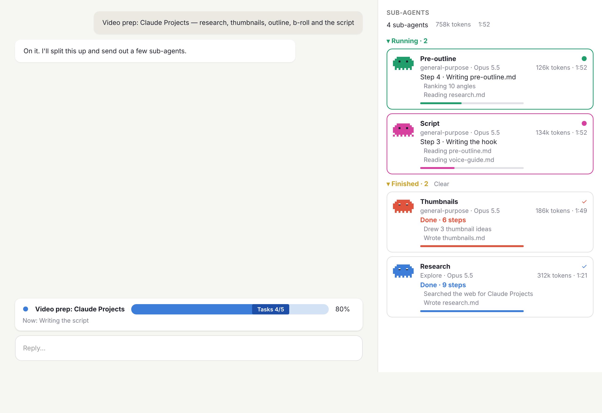

<sub>The creatures, the task bar and the progress lines are drawn by the mod's own `art.ts`; the window around them is a mock-up of the desktop app.</sub>

```text
/plugin install task-hud@claudemod
```

- **A progress bar above the prompt** once Claude writes a to-do list (`TodoWrite`, or `TaskCreate`/`TaskUpdate`): it's titled with the prompt that started the work, fills as each to-do gets ticked off (`Tasks 4/5 · 80%`), and shows the one in progress (`Now: Write the script`). The title survives a reload of the mod. When it shares the band with `clawd-hud`, it draws above the spark. A finished list clears on your next prompt.
- **A Sub-agents pane** that opens the first time Claude sends out a sub-agent, and reopens with `/task-hud`. Each agent gets a pixel creature in its own color that walks while it works. Its card shows the task's description, the agent type and model (`general-purpose · Opus 5.5`), its tokens and run time, the current step (`Step 3 · Reading pre-outline.md`), the steps before it and a progress line. Cards are grouped into **Running** and **Finished**. A finished agent closes its eyes and lists what it did (`Wrote script.md`). A failed one turns gray. An agent sent back to work gets its card back, or a new one if its old card was already dropped. **Clear** drops the finished cards.

Nobody knows ahead of time how many steps a sub-agent will take, so a running agent's line creeps toward 90% as it works and fills only when it finishes. The token count is the size of the agent's context on its latest request.

Tests: `claude plugin test plugins/task-hud`.

## followups: don't lose what Claude notices

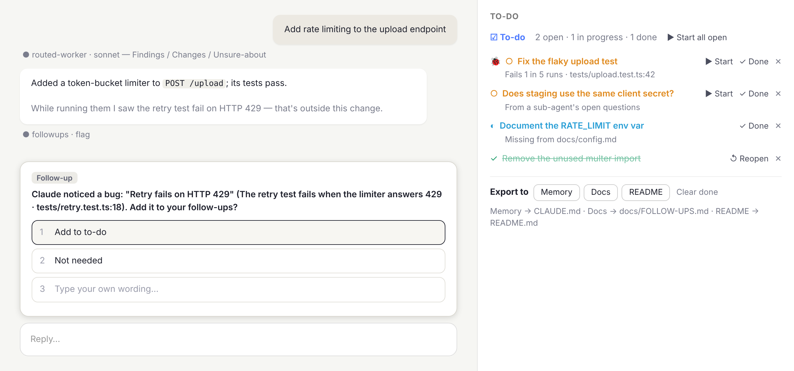

<sub>A mock-up of version 0.5.0, not a screenshot. The dialog is Claude Code's own question dialog, so it looks like the one in your app rather than exactly like this. The pane follows the mod's drawing: orange open, blue in progress, green done, 🐞 for a bug, and an item offered from a sub-agent's open questions. A dialog closed without an answer leaves the item in a band above the prompt (Add to to-do / Skip / Add all), which isn't shown here.</sub>

> **With factory installed:** pressing ▶ Start on a single to-do item hands it to the factory (spec, worktree, build, reviews, PR), not to the main conversation. Set factory's `takeOver` option to `off` to keep Start as it was.

While Claude works, it often notices things outside the task: a flaky test, a stale doc, a bug in nearby code. Those get lost unless somebody writes them down. This mod writes them down.

```text
/plugin install followups@claudemod
```

- **Claude flags what it notices.** The mod gives Claude a `flag` tool and a short system-prompt section on when to use it: things outside the current task that need attention later. Claude doesn't fix them unless you ask.
- **A second look after each answer.** Claude doesn't always remember to flag. After each of its answers (in the main conversation, 200 characters or longer), a small model (haiku) reads the answer, together with the reports any sub-agents handed back since the last answer (where the work, and its loose ends, often is), for problems mentioned but left open: something flaky, unverified, skipped or put off, or an open question or decision that wasn't settled. If it can't run (haiku not allowed on the account, an API error), one line in the transcript says so instead of it failing quietly. Up to 3 of those wait in the band above the prompt. Anything already tracked, or that you said isn't needed (remembered per project, across sessions), isn't offered again. It costs one small call per answer and never delays the end of a turn. Turn it off with the `autoDetect` option (`claude plugin configure followups@claudemod`).
- **A sub-agent's open questions, read directly.** When a sub-agent's report has a section for what it left open (`Unsure-about`, `Open questions` or `Open items`, as the model router's `routed-worker` writes), each line in it is offered in the band as soon as the report comes back. This needs no model, so it works even where the after-answer look can't run. A section that says `none` offers nothing, and the turn's end-of-turn check doesn't stop Claude again for items already offered.
- **A check when the turn ends.** If Claude's final reply says something is unverified, untested or left open (a short English and Hebrew phrase list: `not verified`, `untested`, `known gap`, `open questions`, `לא נבדק`, `פער`, `שאלות פתוחות`, ...; `Open questions: none` doesn't count; not `follow-up`, this mod's own word) and it never called `flag` that turn, the turn is stopped once with a nudge to flag each item or say there are none. It reads the reply whatever its source, so findings relayed from a subagent's report count; phrases in code blocks and inline code don't. It stops at most once per turn, never when `flag` was called (even if you turned the item down), and only in interactive sessions (not `-p` or the SDK). Limits: it is a phrase match, so a reply that leaves something open in other words is missed (the second look above still reads it), and a phrase used in passing can stop a turn needlessly. Add phrases to `STOP_PHRASES` in `hooks/register.tsx`; turn it off with the `stopCheck` option.
- **Claude stops and asks you about each one** in the question dialog: *Claude noticed: "Fix the flaky upload test" (Fails 1 in 5 runs · tests/upload.test.ts:42). Add it to your follow-ups?* You answer **Add to to-do** or **Not needed**, or type your own wording, which is kept as the title. Claude gets your answer back and carries on. If you close the dialog without answering, the item waits in a band above the prompt with **Add to to-do** (`a`), **Skip** (`s`) and **Add all**, so it isn't lost.
- **A To-do pane** lists what you kept, colored by status: orange `○` open, blue `◐` in progress, green struck-through `✓` done. A red 🐞 marks bugs (Claude passes `kind: "bug"` to `flag` for broken behavior; `/followup` adds a plain task). **✓ Done** / **↺ Reopen** toggles an item, ✕ removes it, and `/followup <text>` adds one by hand. With the factory mod installed, **🏭** next to ▶ Start runs an open item through the factory instead (`/factory` with its title, detail and location); the item is in progress meanwhile, and once the PR is open Claude marks it done. The header counts open, in progress and done. The list is saved per project and comes back in the next session (lists saved by older versions are migrated). The project is the git repository: a session in one of its worktrees sees the same list as one in the main checkout. Two sessions open in the same project don't overwrite each other: each save merges with what the other saved, so items added, changed or removed in either one are kept that way. What another session changed shows up here as the session starts (a resumed session too) and as each prompt starts: an item finished or removed there is finished or gone here. When the project has open or in-progress items, the pane opens by itself as the session starts; the `openOnStart` option turns that off. The list is saved on the machine running Claude Code, so it carries over between local sessions but not between cloud sessions, whose container is gone when they end: use **Export to → Memory** for that.
- **▶ Start** (per open item, or **Start all open**) marks it in progress and submits a message to Claude with the item's id, title, detail and location, asking it to do the work. When it finishes, Claude calls the `done` tool with that id and the item turns green. `done` is idempotent, rejects unknown ids, and the prompt tells Claude not to use it for unrelated work. If the message can't be sent, the items go back to open, so you can start them again. Pressing **Add to to-do** twice keeps the item once.
- **Export to:**

| Button | Writes to | Why |
|---|---|---|
| Memory | `CLAUDE.md` | Claude reads it at the start of every session |
| Docs | `docs/FOLLOW-UPS.md` | a page of its own |
| README | `README.md`, under *Known issues & follow-ups* | visible to everyone |

The export is a markdown checklist (`[ ]` open, `[x]` done, in-progress items tagged `_(in progress)_`, bugs `_(bug)_`) between `<!-- followups:start -->` and `<!-- followups:end -->` markers. Exporting again replaces that section in place, and the rest of the file is left alone.

Tests: `claude plugin test plugins/followups`.

## rtl-toggle: Hebrew and English on one line

| Toggle off | Toggle on |
|---|---|
|  | 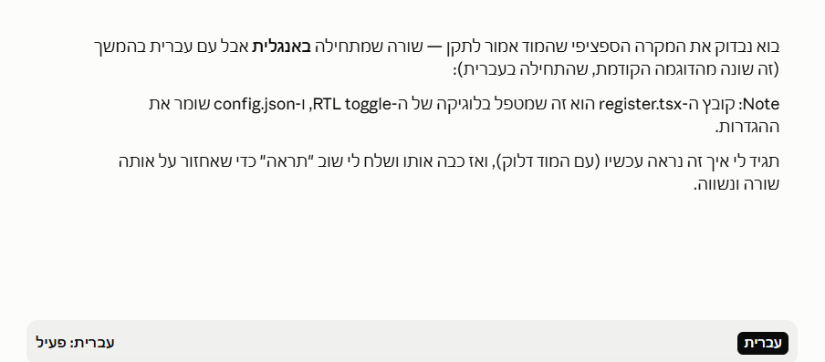 |

A line that starts in English but is mostly Hebrew (or Arabic, or another right-to-left script) can render out of order, with the Hebrew words shifted. This mod fixes those lines in your messages and Claude's.

```text
/plugin install rtl-toggle@claudemod
```

- **A button above the prompt** (`עברית: פעיל` / `עברית: כבוי`) turns the fix on or off for the session. `/rtl` does the same on every surface, and `/rtl on`, `/rtl off` and `/rtl status` set or report it.
- **What it changes:** a line that starts with an English letter but has at least as many RTL words as LTR words gets one invisible leading RLM (U+200F). That gives the line a right-to-left base direction and right alignment, like a line that starts in Hebrew. Nothing else in the text changes.
- **What it leaves alone:** code blocks (fenced and indented), lines that already start in Hebrew, lines with no RTL text, and inline code, links and URLs, which aren't counted. Table rows are fixed cell by cell, except in the terminal.
- **Limits:** the mod API has no `dir` or alignment prop, so alignment comes only from the RLM. That works where the surface picks the direction per block (the desktop app). In a terminal it depends on the terminal's own bidi support. Messages already on screen keep their layout until they're drawn again.

It also lives in its own repo, [Amitro123/RTL-claude-mod](https://github.com/Amitro123/RTL-claude-mod), which has the full rules and the performance notes.

Tests: `claude plugin test plugins/rtl-toggle`.

## goal-run: a goal for the session

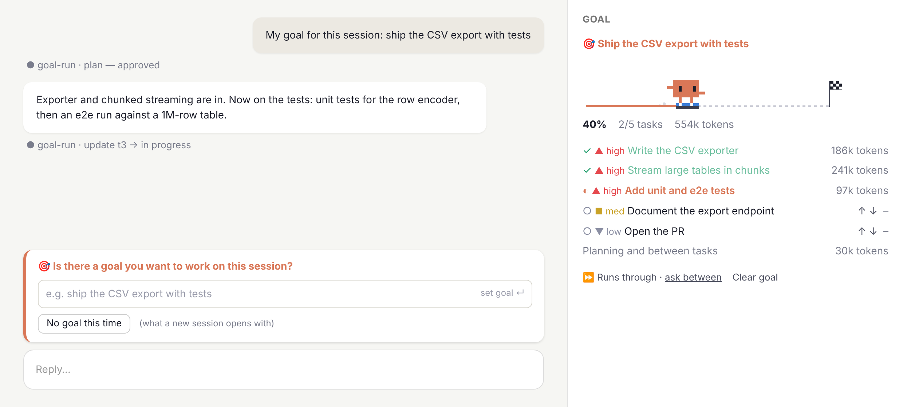

<sub>Mock-ups, not screenshots: the track and the runner are drawn by the mod's own `art.ts`, and the band, the pane and the dialogs follow its layout. The dialogs are Claude Code's own, so yours will look like your app's.</sub>

> **With factory installed:** a new goal, set here or planned by Claude, goes to the factory (spec, worktree, build, reviews, PR) instead of being worked in the main conversation. Set factory's `takeOver` option to `off` to keep goals here.

```text
/plugin install goal-run@claudemod
```

### How a goal runs

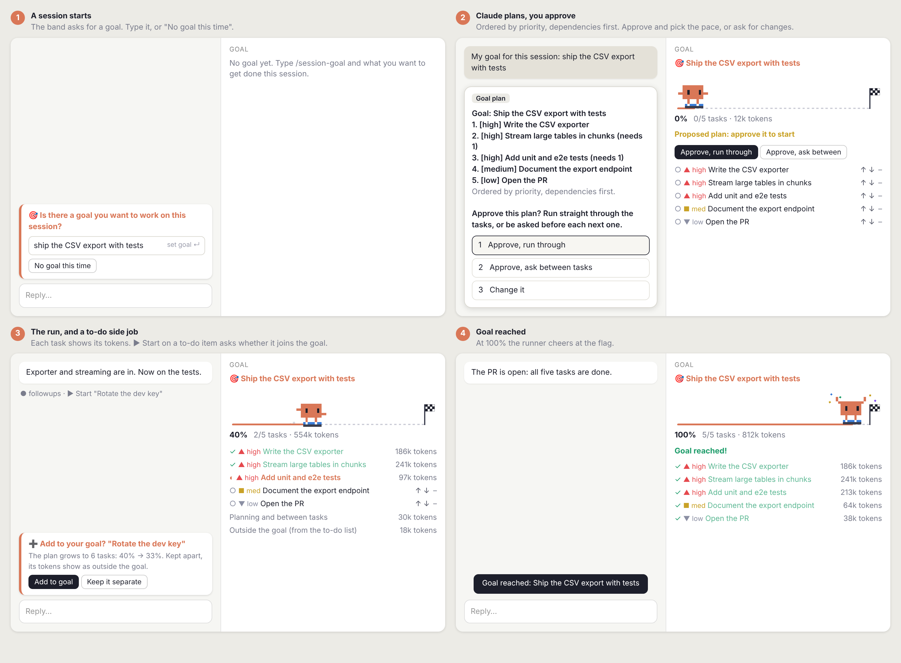

1. **The question.** When a session starts, a band above the prompt asks *Is there a goal you want to work on this session?*, with a field to type it. **No goal this time** dismisses it. If an earlier session in this project left a goal unfinished, the band offers **Continue**, **New goal** or **Not now** instead.
2. **The plan, by priority.** Your goal goes to Claude, which breaks it into 3 to 8 tasks with the `plan` tool. Each task has a priority (high, medium or low) and the tasks it depends on. The plan is ordered highest priority first, except that a task comes after what it needs: tests come after the code they test, and say so (*needs 1*).
3. **Your approval, and the pace.** The plan is put to you in a dialog, each task with its priority. Pick **Approve, run through**, **Approve, ask between tasks**, or **Change it** (Claude revises and asks again). Nothing starts before you approve. If you close the dialog, the plan waits in the pane with both approve buttons.
   - **Run through:** Claude goes from task to task on its own. If it tries to stop with tasks left, it's sent on once; it can still stop when it's blocked or needs your decision.
   - **Ask between tasks:** after each task, a dialog asks *"Add tests" is done (40%). Go on to "Document the endpoint"?*, with **Continue** or **Stop here**.
   - A button in the pane switches between the two while you work.
4. **The run.** The Goal pane shows the goal, a track from 0 to 100%, and a pixel Claude in blue sneakers. It stands still between tasks, runs while one is in progress, and cheers at the flag at 100%. Claude marks each task in progress and done with the `update` tool, and takes the first pending task in the list's current order. Each of your prompts while the goal is open carries the plan's state, so Claude keeps track of where it is.
5. **What each task cost.** Every model request, sub-agents' included, is counted against the task in progress, and the pane shows each task's tokens. Planning and work between tasks have a line of their own. The count is the new tokens of each request (output, input written to the cache, uncached input). Cache reads are left out: they are the context earlier requests already counted, and counting them again on every step would grow the number far past what the task added. It is not a price.

### Steering it while it runs

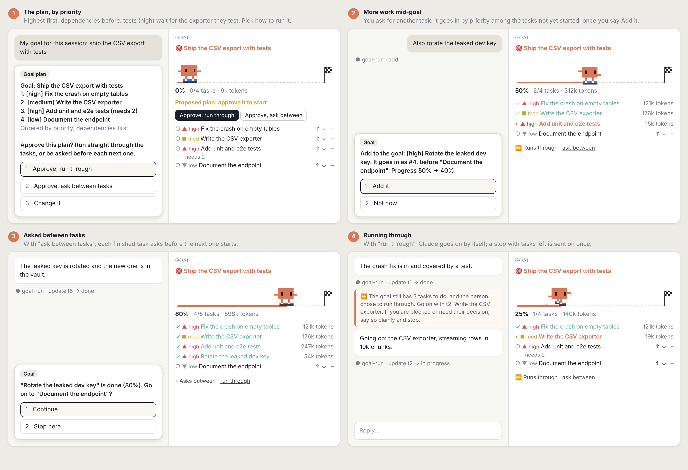

- **Reorder.** **↑ ↓** in the pane move tasks that haven't started. A task moved up takes the tasks it needs along with it, and one moved down takes the tasks that need it, so dependencies stay first. Claude works the list as you leave it.
- **Add a task.** Ask Claude for more work during the goal, and it uses the `add` tool with a priority and what the task needs. The task goes in among the tasks that haven't started, by priority and after anything it needs. A dialog shows where it lands and what that does to the percentage (*It goes in as #4, before "Document the endpoint". Progress 50% → 40%*), and you choose **Add it** or **Not now**. Done and in-progress tasks stay where they are. The goal's text doesn't change, but the plan grows, so the percentage drops to match the work added.
- **Re-plan.** A new plan in the middle of a goal keeps the done tasks and their tokens.
- **Work from followups' to-do list.** Pressing **▶ Start** on a to-do item while a goal is open is a side job. Claude gets no goal reminder with it, so the two don't compete, and its tokens show on a line of their own, *Outside the goal*. The band above the prompt asks whether to **Add to goal**, showing what that does to the plan (*grows to 6 tasks: 40% → 33%*), or **Keep it separate**. Added, the item becomes a task in progress, carrying the tokens it used so far, and a bug comes in as high priority. It turns done when followups marks the item done. The side job ends when you send a prompt of your own.

### Commands and options

- `/session-goal <text>` sets a goal at any time, `/session-goal` shows it, and `/session-goal clear` drops it. Claude Code has its own `/goal`, so the mod's command has a different name.
- The goal is saved per project on the machine running Claude Code, like followups' list, so it carries over between local sessions in the same project. The project is the git repository, so a session in one of its worktrees (the desktop app can give each session its own) sees the same goal as the main checkout. What another session did to the goal (progress, a new goal, a goal cleared) shows up here as the session starts, a resumed one too, and as each prompt starts. If two sessions in the folder each set a goal, the one set later is the one saved. The other session is told once, with a toast, that its progress isn't saved.
- `askOnStart` (`on` / `off`) turns the start-of-session question off.
- **🏭 Run as factory.** With the factory mod installed, the Goal pane offers to run an open goal through it: `/factory` with the goal's text. The spec's plan then replaces the goal's, and the factory's builder does the tasks.
- **A plan from factory.** When the factory's spec is put to you as the goal's plan, the dialog is titled *Factory plan* and offers **Approve, start building** or **Change it**. Approved, the factory's builder does the tasks and marks them, and the main Claude is told not to: there's no goal reminder on your prompts, no nudge at a stop and no question between tasks. Changes go back to the factory's spec-writer. Approving later in the pane runs `/factory plan-approved`. If you already have a goal of your own that isn't done, it stays: the factory's plan isn't set as the goal, and the factory asks for approval in its own band. A factory plan starts fresh, without an earlier goal's done tasks.

Tests: `claude plugin test plugins/goal-run`.

## brain-hud: the agent's memory, made visible

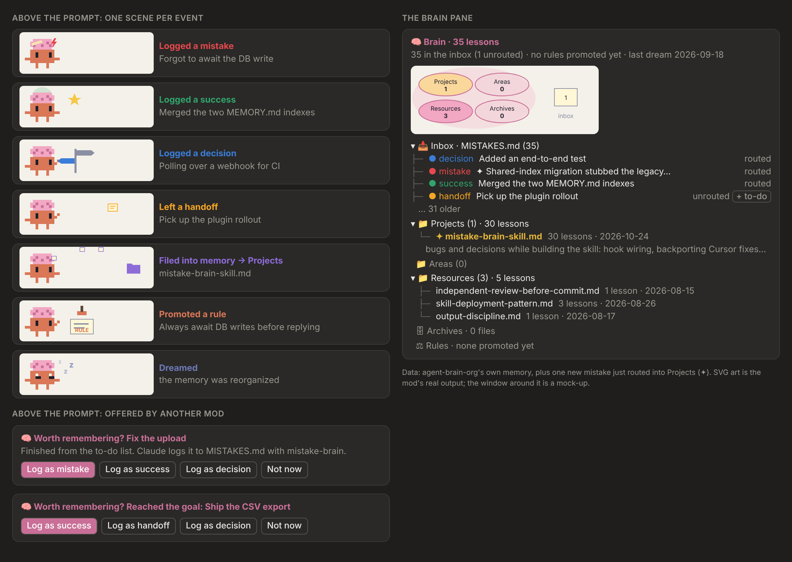

<sub>The scenes and the brain map are the mod's own SVG output; the windows around them are mock-ups. The data is a real project's memory, with one new lesson just routed into Projects (✦).</sub>

brain-hud gives Claude a memory that lasts between sessions, and shows it. The **mistake-brain** skill ships inside it, with its hooks. Claude logs what happened to `MISTAKES.md` (a mistake, a success, a decision or a handoff). It routes those entries into PARA folders under `.agent-brain/shared/` (Projects, Areas, Resources, Archives), promotes a lesson that repeats into a rule (with your approval), and now and then reorganizes the memory ("dream"). The mod shows that memory as it grows. Nothing else needs installing.

```text
/plugin install brain-hud@claudemod
```

Then, in each project that should remember: `/brain-hud:mistake-brain init`, or **Set up memory** in the Brain pane (`/brain`). It creates `MISTAKES.md`, the PARA folders, the index `.agent-brain/shared/MEMORY.md` and the standing rules. A `CLAUDE.md` tracked in git is left as it is; the instruction goes into `.claude/rules/mistake-brain.md`.

### The skill, built in

- **The command** is `/brain-hud:mistake-brain` with `log`, `route`, `promote`, `dream`, `recall`, `init` or `update`. Claude also runs it on its own: after a fix, a revert or a correction it logs an entry, and with 3 or more entries waiting it routes them.
- **The hooks come with the plugin.** At session start the index is put in Claude's context with what's waiting. A revert or a discarded change drafts a mistake entry. A failing test, lint or typecheck is kept as a candidate until the fix is confirmed. A write to `MISTAKES.md` asks for routing, or surfaces patterns ready to become rules. They run in every project, and do nothing in one without `MISTAKES.md` or `.agent-brain/`. They need Python 3 (`python3`, or `python` on Windows); without it they're skipped and the session goes on. Each hook command runs `sh`, which on Windows comes with Git for Windows (Git Bash), the same install Claude Code itself uses there.
- **The index keeps itself right.** Each file's lesson count and last date are facts on disk, so a script writes them (`rebuild_index.py`), never the model: at session start, after a lesson file is written, and at the end of `route`, `dream` and `init`. Claude writes only each file's one-line summary. A line the script doesn't recognise, or one for a file since removed, is left for `dream` to decide on.
- **Rules need your approval.** `promote` proposes a rule for `CLAUDE.md` or `.claude/rules/` after a pattern repeats 3 times, and writes it only after you say yes. Setting `AGENT_AUTO_IMPROVE=1` in the environment lets it write rules without asking, rules that change how Claude behaves in every later session; it's off by default.
- **Coming from a separate install of the skill** (`~/.claude/skills/mistake-brain`): run `/brain-hud:mistake-brain init` once in each project. It removes the hooks the old install registered in `.claude/settings.local.json`, so none fires twice, and tells you to delete the old folder, which would load as a second, older skill. It reports a tracked `.claude/settings.json` that still has them, rather than editing it. The memory files themselves are the same format and carry over.
- What changed when it moved into the plugin: `plugins/brain-hud/skills/mistake-brain/HISTORY.md`. Its Python tests: `python -m pytest plugins/brain-hud/tests/skill` (CI runs them).

- **A pixel Claude with a brain**, above the prompt, plays a short scene whenever the memory changes:

| Event | Scene |
|---|---|
| a `mistake` entry | a spark off the brain, then a plaster on it |
| a `success` entry | the brain glows green, with a star |
| a `decision` entry | a signpost, the chosen arm lit |
| a `handoff` entry | a note passed on |
| an entry routed into a folder | notes fly from the brain into the folder |
| a rule promoted | a stamp comes down on a rule sheet |
| a dream | Claude asleep, Zs rising |

  In the terminal the scene is a text face, e.g. `🧠ϟ(>_<)` for a mistake. A write through Claude's Edit or Write shows at once; a change from anywhere else (the skill's own hooks, a script) is picked up within a few seconds.
- **A Brain pane** (opens by itself on the first change of a session, and any time with `/brain`) shows the memory. One line on top counts the lessons and the entries still unrouted. Lessons are counted from the PARA files themselves (one per `## [date] title` heading), so the count is right even when `MEMORY.md` is missing or its lines have no lesson counts; the index gives each file's summary. When the index explains an odd picture, a warning under it says so: no `MEMORY.md` found (then no lessons are counted), or PARA files on disk that it doesn't list. The bottom line names the `MEMORY.md` it read. That is mistake-brain's index in the project (`.agent-brain/shared/MEMORY.md`, or the older `.claude/agent-memory/claude/MEMORY.md`), not Claude Code's own memory file under `~/.claude`.
  - **On desktop, a knowledge graph.** `MEMORY.md` sits at the centre, linked to the four PARA folders, each folder to its files (bigger the more lessons they hold), and every `MISTAKES.md` entry is a dot, colored by type, linked to the file it was routed to (its `PARA route`). Entries not routed yet wait in an inbox cluster with no link, as many as the unrouted count; an entry routed somewhere the graph has no node for (a rule, say) is counted under `MEMORY.md` instead. When an entry is routed, its dot travels from the inbox to its file and the file glows; a new entry glows where it lands. Each folder's files stand in a column on its outer side, one row per file, so labels never meet (up to 7 a folder, the rest as "+N more"). The layout is fixed, so the graph doesn't jump between refreshes, and its palette follows the theme in `/config` (dark unless it's a light theme).
  - **Below the graph, and alone in the terminal, a tree:**
    - **📥 Inbox**: the 3 newest `MISTAKES.md` entries, colored by type, with their status.
    - **📁 Projects, Areas, Resources** and **🗄 Archives**: each PARA file with its lesson count and date, counted from the file; the file that just changed shows its summary too. A file on disk that `MEMORY.md` doesn't name shows as *not in MEMORY.md*, the gap the skill's dream fixes.
    - **⚖ Rules**: what has been promoted, once there is something.
    - What just changed is marked ✦.
- **Entries waiting to be routed.** With 3 or more unrouted entries, the band above the prompt says *🧠 N entries to route* with **Route now** (`r`), which runs `/brain-hud:mistake-brain route` (or asks Claude to, where the command can't be run), and **Later**, which waits until more come in.
- **With the other mods.**
  - **followups:** when Claude finishes a to-do item you started (its `done` tool), the band asks *Worth remembering?* in one line: **Log as** the suggested type (a bug as a mistake, anything else as a success), **…** for the other types, and **Not now**. A press asks Claude to log it with `/brain-hud:mistake-brain log`, so the entry keeps the skill's format.
  - **goal-run:** a reached goal is offered as a success or a handoff, named as you set it. A goal a to-do item closed is offered too when goal-run's note on followups' `done` result reaches brain-hud; that depends on the order the mods load in (see below).
  - The offer's hotkeys are `l` (log as the suggested type) and `m` (the other types), clear of followups' (`a`, `s`) and goal-run's (`g`, `k`, `c`, `n`) in the same band. No digits: Claude Code passes a digit typed into an empty prompt box to the band, so a prompt starting with `1.` would have logged to memory.
  - A **handoff** entry in the pane has **+ to-do**, which adds it to followups' list with `/followup`.
  - **How they hear each other.** followups and goal-run answer their own tools (`done`, `plan`, `update`) and stop there, so another mod's hook on those tools runs only when that mod sits above the owner, and Claude Code doesn't promise an order among installed mods. brain-hud and goal-run therefore also read each of those calls from the `PostToolUse` event, which every mod sees whatever the order; an offer, or a task closed, happens once whichever arrives first. Not yet checked in a live session with all the mods installed: with `claude --debug`, a line `<event> bypassed by <plugin>` for these tools would mean a hook was skipped.
- In a project with no `MISTAKES.md` and no `.agent-brain/` the mod stays quiet; the pane offers **Set up memory**, which runs `/brain-hud:mistake-brain init`.

### The session journal

Memory between sessions is the skill's; the journal is for the session you're in. Work that goes to sub-agents (a model router's worker on a cheap model, an `Explore`, a factory role) comes back to the main agent as a bottom line, which keeps its context small. What each worker found, where, and what it left open would then be gone. brain-hud writes it down as it happens, with no model involved:

- **One line per event**: each sub-agent's report (what it was asked, its first findings, what it changed, its files, its open questions, read from a routed-worker's *Findings / Files / Changes / Unsure-about* sections or from the report's first line), each `MISTAKES.md` entry, each to-do finished through followups, each goal step and approved plan from goal-run.
- **The `journal` tool** (`mcp__brain-hud__journal`, optional `last`) hands Claude the journal, so it can look up what a worker found earlier instead of re-reading the files or sending another worker.
- **One line beside your next prompt** when the journal grew, e.g. *Session so far: 3 worker reports, 1 memory entry, 2 open questions. Latest: …*; no line when nothing new happened.
- **A copy on disk** at `.claude/brain/session-<id>.md`, added to the repository's `.git/info/exclude` so it is never committed. One file per session; delete old ones whenever you like.
- **A handoff at the end.** When the session ends with something open (a worker's open question, a to-do started and not done, a goal not reached) and the project has a mistake-brain memory, brain-hud adds a `Type: handoff` entry, *Session handoff (auto-draft)*, below the marker in `MISTAKES.md`, with the next steps and a pointer to the journal file. It is unrouted like any entry, so the next session's route files it. Nothing open, no entry.

Options: `journal` (`on`/`off`) and `handoffDraft` (`on`/`off`), both on by default.

If you also run a router mod with a budget on work tools per prompt, exempt `mcp__brain-hud__journal` (and followups' and goal-run's tools) from it: a lookup in the journal is meant to replace reading files, not count as reading them.

### The memory graph

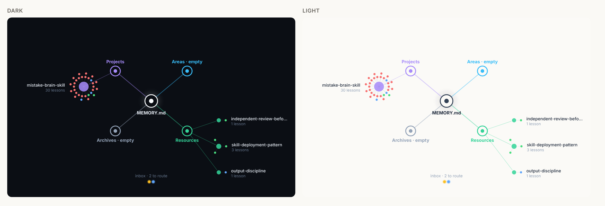

<sub>The palette follows the theme in `/config`. The graph is the mod's own SVG, drawn from a real project's memory: 30 lessons in one Project file (its ring of mostly red dots is the mistakes that taught them), 3 Resource files, empty Areas and Archives, and 2 entries still in the inbox.</sub>

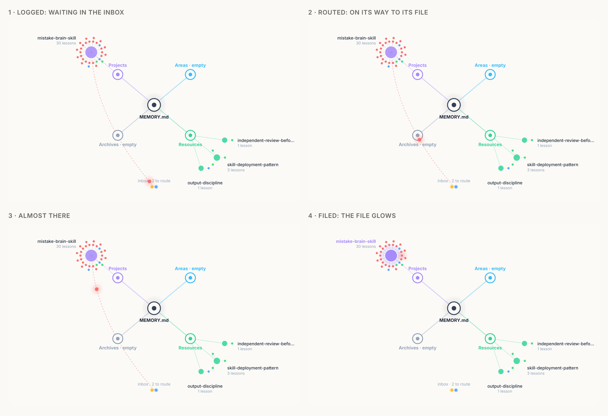

<sub>When the skill routes an entry, its dot travels from the inbox to the file its `PARA route` names (about two seconds), then the file glows.</sub>

Tests: `claude plugin test plugins/brain-hud` (the mod) and `python -m pytest plugins/brain-hud/tests/skill` (the skill).

## factory: a software factory

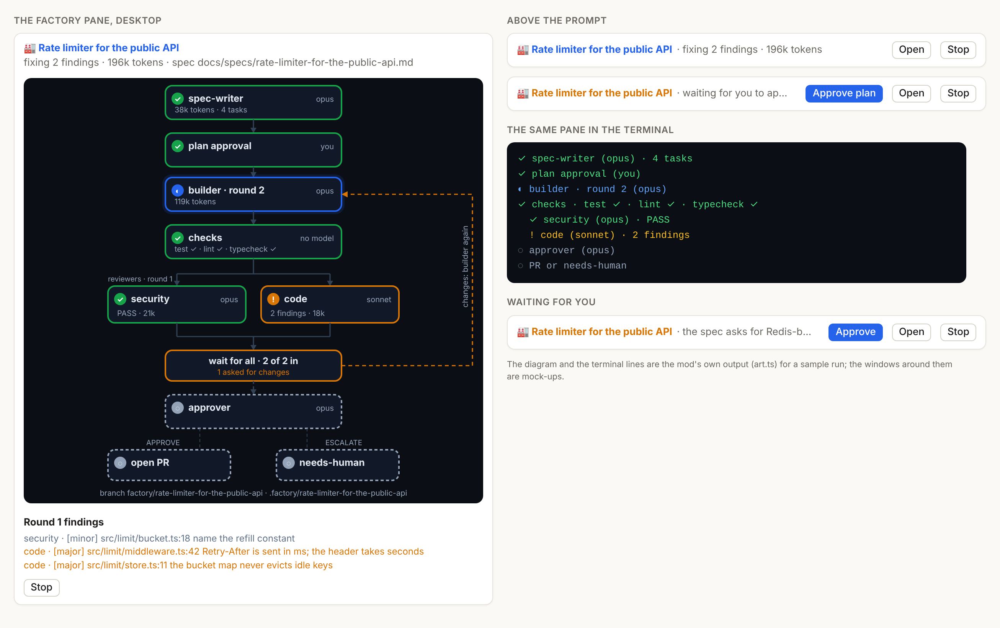

<sub>The diagram and the terminal lines are the mod's own output (`art.ts`) for a sample run; the windows around them are mock-ups.</sub>

A feature goes in and a reviewed PR comes out. Each step is a sub-agent with its own role and model, and the mod runs the order as code, so no step is skipped: the reviews always happen, every reviewer is waited for, and the round limit holds. It's aimed at backend work, so it runs no UI checks.

> **It takes over goals and to-do items by default.** With the `takeOver` option on (the default), a new goal in goal-run and a single to-do item started in followups run through the factory instead of the main conversation. Set it to `off` if you want the factory only when you ask for it (`/factory`, the start tool, the 🏭 buttons).

```text
/plugin install factory@claudemod
```

### How a run goes

```text
/factory <feature>
  spec-writer (sonnet)  writes docs/specs/<slug>.md, a task list and the feature's size
  plan approval (you)   in goal-run's dialog, or the factory's own (and its Approve plan button)
  builder (sonnet,      implements on branch factory/<slug>, in the worktree .factory/<slug>
   opus when large)
  checks (no model)     installs the dependencies once, then tests, lint, typecheck; red goes back to the builder (2 passes)
  reviewers, at once    security (opus) and code (sonnet): VERDICT PASS or CHANGES, with findings
                        any CHANGES, with rounds left: the builder again, then every reviewer again
  approver (opus)       APPROVE: the PR waits for your Open PR, then Claude pushes the branch and opens it
                        ESCALATE: the run waits for you (Approve PR, or /factory stop)
```

1. **The spec.** A run starts by itself when you set a goal in goal-run, or press ▶ Start on one to-do item in followups (the `takeOver` option, on by default): the main Claude is told the factory has it and doesn't do the work itself. It also starts from `/factory Add a rate limiter to the API`, **🏭 Run as factory** on a goal, or **🏭** on a to-do item. Text you pasted into the command loses the paste's wrapper. It creates a git worktree on a new branch from your current commit, so the work never touches your working copy. The worktree sits inside the repository, in `.factory/<slug>`, listed in git's exclude file so it's never committed. Inside, the agents' edits get the same permissions and sandbox as yours; a folder outside the working directory would prompt for every edit, or be refused where only the repository is writable. A tool in your checkout that scans every folder may see the worktree's copy of the code while a run lasts; point it past `.factory/` if it does. The spec-writer writes the PRD, the technical spec and the acceptance criteria to `docs/specs/<slug>.md`, and ends with 3 to 8 tasks, each with a priority and the tasks it needs.
2. **The plan is goal-run's.** With goal-run installed, the spec's tasks become the session goal's plan and its dialog is the factory's human gate. No code is written before you approve. **Change it** sends your words back to the spec-writer. Without goal-run, or when you already have a goal of your own in goal-run (the factory's plan doesn't replace it), the factory asks in a dialog of its own in the conversation: **Approve and build**, **Not now**, or what to change under *Other*. **Approve plan** stays in the band and the pane until you answer.
3. **Build and checks.** The builder implements the tasks in the worktree, marks them in goal-run as it goes, and commits; anything it leaves uncommitted the factory commits, so what is reviewed is what is pushed. Except new files that should never be committed: installed dependencies (`node_modules/`, `.venv/`), build output (`dist/`, `build/`) and credentials (`.env*`, `*.pem`, `*.key`) are left out, and the pane and the PR prompt say which. A fresh worktree has no dependencies installed, so before the first checks the factory runs the `setup` option, or the lockfile's install when `node_modules` is missing (`npm ci`, `pnpm install --frozen-lockfile`, `yarn install --frozen-lockfile`). A failed setup stops the run for you rather than sending the builder after it. Then the checks run with no model: the `checks` option, or what the project has (`npm test` and its `lint` and `typecheck` scripts, `pytest`, `go test`, `cargo test`). A failure goes back to the builder with its output, twice at most; reviewers only ever see a green build. A later round (review findings, red checks, your rework) goes back to the same builder with only what to fix: it keeps what it read and why, and its prompt cache. If it can't take the message, a new builder gets the whole job.
4. **Reviews.** The security and code reviewers read the spec and the branch's commits (`git diff <base>..HEAD`) in parallel. Each ends with `VERDICT: PASS` or `VERDICT: CHANGES` and findings tagged `blocker`, `major` or `minor`. A missing verdict counts as changes, and so does a PASS that lists a blocker. With changes and rounds left (`maxRounds`, 2 by default), a fresh builder gets the findings, and every reviewer looks again: a fix for the code reviewer is new code for the security reviewer too.
5. **The approver**, an agent, reads the spec, the diff and the verdicts. On **APPROVE** the run waits for you: **Open PR** (or `/factory approve`) sends the main Claude a prompt to push the branch and open a PR, with the spec in it and the minor findings listed under "Not fixed". With `autoPr` on, that prompt goes as soon as the approver approves. On **ESCALATE** the run waits at *needs-human* with the reason, and **Approve PR** opens the PR anyway.
6. **When something else stops the run** (no task list, a builder that stopped, checks still red, a failed setup, an agent that couldn't start, a reviewer or the approver that ended without a verdict), it waits at *needs-human* with the reason and offers **Retry**, which runs that step again; there's no approving past it into a PR. An agent that ends without its answer says why: an API error and its message, a refusal and its explanation, or an interruption. On an API error the agent is started once more on the session's own model, in case the account can't use the role's model. A builder that stopped mid-job (an API error, a spend or rate limit) keeps its place: **Retry** sends the same builder on, to carry on from where it stopped with its own context, and a limit error waits for your Retry instead of switching models. If it can't be sent on, a new builder is told what is already in the worktree (its commits and uncommitted changes, from git) and starts from there. A reviewer that failed doesn't count as asking for changes, so the builder isn't sent after it, and **Retry** runs only that reviewer; an approver that failed decided nothing, so it's **Retry**, never Approve PR. The factory already picks each role's model by the feature's size (`models` below), so a mod that rewrites sub-agents' models (a model router) should leave an agent spawned with an explicit model on it.

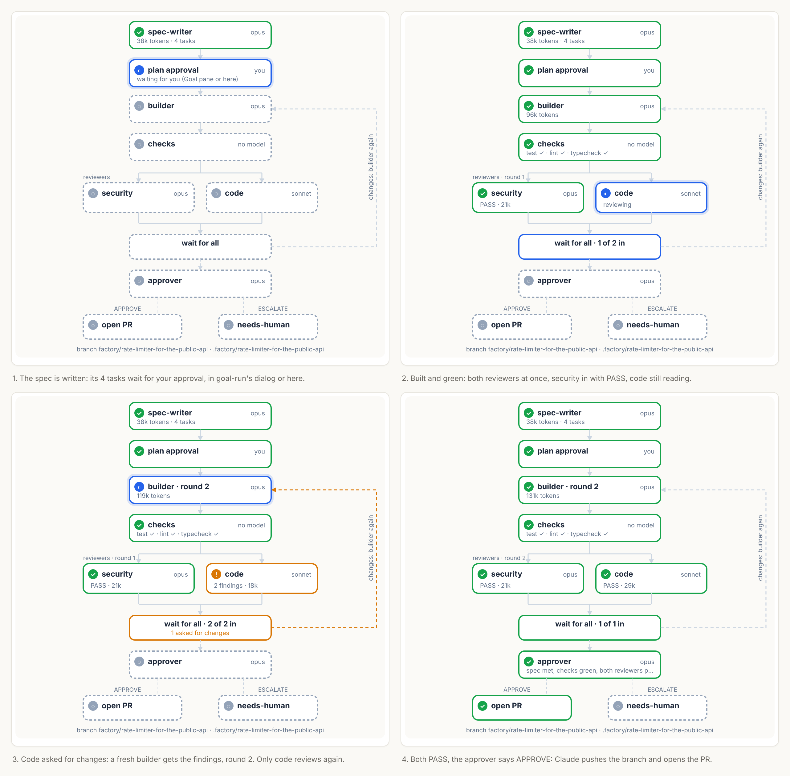

<sub>The pane's diagram at four points of one run, in the light theme: the plan waiting for you; the reviewers at once; code asks for changes, round 2; approved, the PR waiting for your Open PR.</sub>

### What you see

- **What it did.** Every step's own words go to the run's record, numbered files in `.factory/<slug>.record/` beside the worktree (out of git): the spec-writer's answer, each builder round, the diff stat after it, the checks, each review, the approver's decision. The pane shows *Changed:* (git's count and the builder's closing summary) and where the record is. When the approver approves or escalates, the PR is asked in a dialog in the conversation, with the same summary: **Open the PR** (or **Approve the PR anyway**), **Not now**, or what to change under *Other*, which sends it back to the builder.
- **The Factory pane** (`/factory` opens it) draws the pipeline: each box with its model, its state (waiting, running, PASS, changes, skipped, failed) and its tokens, the reviewers side by side, the loop back to the builder with its round, and the branch. Under it are the current round's findings and the failing checks. In the terminal it's the same pipeline as text lines with ✓ ! ◐ ◌ marks. The palette follows the theme in `/config`.
- **The band** above the prompt: *🏭 Rate limiter · reviewing, round 1 · 184k tokens*, with **Approve plan**, **Open PR**, **Approve PR** or **Retry** when the run waits for you, **Open** and **Stop**.
- **task-hud** shows each of the factory's agents as a creature, named by run and role (*factory · security review*), with no change to task-hud.

### Commands and options

- `/factory <feature>` starts a run (one at a time). `/factory` alone opens the pane and, with nothing running, asks Claude to start a run on the work the conversation is about. Claude can also start one itself with the `mcp__factory__start` tool, when you ask for the factory in words ("run it in the factory"). `/factory approve` approves the plan or the PR (after APPROVE or ESCALATE), `/factory retry` runs again the step that stopped the run, `/factory rework <what to change>` sends the change back to the builder with your words once the run waits for you (the PR ready, an escalation), and `/factory stop` ends the run. A stopped run's agents can't be aborted, so the factory refuses their every tool call: they stop editing and spending. The branch and the worktree stay; remove them with `git worktree remove` when you're done.
- `checks`: commands to run after each build, separated by `;` (run without a shell). Empty: the project's own `.factory/checks.json` at the repository's root (a list of commands; one the builder writes in its worktree doesn't count), else what detection finds (node, python, go, cargo, make, maven, gradle and dotnet, at the root, one folder down and in the folders the change touched; CI files such as `azure-pipelines.yml` are never read), plus the plain check commands the spec's acceptance criteria name (`pytest`, `npm test`, `make test`...). A check whose program isn't installed is skipped and said so, not failed. With no check run at all, the approver can't approve on its own: the run escalates to you. Commands the factory found itself run only once you let them (see the question it asks); set this option for runs nobody watches.
- `setup`: commands that install the dependencies in a run's worktree before its first checks, e.g. `npm ci`. Empty uses the lockfile when `node_modules` is missing.
- `takeOver` (`on` / `off`): `on` runs a goal through the factory instead of the main conversation: one set from goal-run's band or `/session-goal`, and one Claude plans itself from the conversation (goal-run then answers its plan call by telling it to start the factory). One to-do item started in followups goes too; several started together stay the main conversation's, and so does re-planning a goal already under way. `off` leaves only `/factory`, the start tool and the 🏭 buttons.
- `autoPr` (`off` / `on`): `on` opens the PR as soon as the approver agent approves; `off`, the default, waits for your Open PR.
- `models` (`auto` / `fixed`): which model each role runs on. The spec-writer, the builder and the code reviewer run on sonnet; the security reviewer and the approver on opus, where a miss costs most. In `auto`, the default, the spec-writer also judges the feature `SIZE: small | medium | large` (large: it spans several modules, needs design decisions such as the data model, migrations, security or concurrency, or leaves real questions open), and a large one runs the builder on opus. The pane shows the size and each role's model. `fixed` keeps the table whatever the size.
- `skills`: the skills a role loads before its job, in place of the factory's own, as `role=skill,skill; role=skill` (roles `spec`, `builder`, `security`, `code`, `approver`), e.g. `spec=spec-pack; security=security; code=code-review; builder=unit-test`; `role=none` loads none. Empty, the default: each role loads the factory's own skill (below).
- `maxRounds` (`1`, `2`, `3`): how many times reviewers may send the builder back before the approver decides on what there is.
- The roles are agent types, `factory:spec-writer`, `factory:builder`, `factory:security-reviewer`, `factory:code-reviewer` and `factory:approver`, hidden from the model so only the factory runs them. Each one loads a skill of the factory's first, shipped in `plugins/factory/skills/`: `factory:spec-writer` (read first, problem, scope, design with failure modes, testable criteria, tasks, size), `factory:builder` (task by task with tests, later rounds fix only what's listed), `factory:security-reviewer` (trace untrusted input through the diff, auth, secrets, defaults, dependencies), `factory:code-reviewer` (each acceptance criterion to its code and test, failure modes, fit) and `factory:approver` (approve or escalate, and always escalate a change to auth, payments, secrets, deploy or CI config, production data or user notifications). Reading is the costliest part of a run, so the spec ends with a **Code map** (the files, functions and line ranges that matter, the type signatures from large files, the test commands): the builder and the reviewers start from it instead of reading the code again, and their skills say to search before reading, read by range, and never read a large file such as type definitions whole. The skills hold the method; the mod's prompts keep the inputs and the answer format it reads (TASKS, VERDICT, DECISION), so a skill of your own can't break the run.

Not yet: reviewers chosen by the diff (database, API, tests, logging), minor findings offered to followups, and an ESCALATE offered to brain-hud. Not yet run end to end in a live session: the tests drive the engine's events with the agents, git and the checks stubbed.

Tests: `claude plugin test plugins/factory`.

## Developing

Each mod's `tsconfig.json` extends `.claude-plugin/types/tsconfig.json`. Claude Code writes that folder (the API types for your build) the first time it loads the mod, so a fresh clone doesn't have it, and it's git-ignored. To type-check a mod:

```bash
claude --plugin-dir plugins/<mod>   # an interactive session; once the mod loads, .claude-plugin/types/ is there
tsc -p plugins/<mod>
```

Run each mod's tests with `claude plugin test plugins/<mod>`; they don't need the types folder, nor credentials. CI runs them for every mod.

The tests check the code; the evals in `plugins/<mod>/evals/` check what the model does with it (does it flag a bug it passes, call the plan tool for a goal, hand a factory request to the start tool, log a fix to memory). Each case runs with the plugin and without it, and reports the difference. They are real model calls, so they aren't in CI:

```bash
cd plugins/<mod>
claude plugin eval . --trust-plugin --scaffold --runs 3 --max-cost-usd 5 --allow-tools "mcp__<mod>__*" Write Edit
```

A case that needs the shell also needs `--allow-tools Bash`. The run refuses it on a machine where the shell can't be sandboxed.

The wording one mod writes and another reads (followups' Start prompt and `done` result, goal-run's goal prompt and reached-goal texts, the factory plan's outcomes) lives in `shared/texts.ts`, together with its parsers. A mod can import nothing outside its folder, so followups, goal-run, brain-hud and factory each keep a generated copy in `hooks/texts.ts`. Edit `shared/texts.ts`, then run `node tools/sync-texts.mjs`. CI runs it with `--check` and fails on a stale copy.

## License

MIT, see [LICENSE](LICENSE).

## Regenerating the GIF

The GIF is rendered from the plugin's real `scene.ts` and `gauges.ts`, so it is not a mock-up:

```bash
cd demo
npm install
node render-frames.mjs   # needs Node ≥ 22.18 or ≥ 23.6 (runs the .ts files with built-in type stripping)
python make-gif.py       # needs Pillow
```
